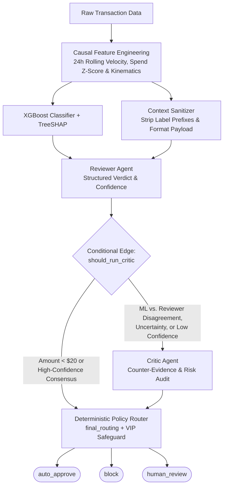

# Hybrid Multi-Agent Fraud Detection System (XGBoost + SHAP + LangGraph)


A cost-sensitive financial fraud triage pipeline that pairs a gradient-boosted baseline (**XGBoost + TreeSHAP**) with an asynchronous multi-agent **LangGraph** workflow (**Reviewer** and **Critic** LLM agents) governed by a deterministic policy router.

Evaluated on **2,345 adversarial test transactions** (2,145 confirmed frauds and 200 hard-negative legitimate transactions), adding multi-agent contextual auditing reduces false-positive customer blocks by **61.5%–82.0%** and generates **$61,988–$73,357 in net operational savings** per batch at a nominal LLM inference cost of **$0.26–$1.04**.

---

## Table of Contents
1. [Business Problem & Asymmetric Cost Structure](#1-business-problem--asymmetric-cost-structure)
2. [System Architecture & Workflow](#2-system-architecture--workflow)
3. [Experimental Setup & Hard-Negative Mining](#3-experimental-setup--hard-negative-mining)
4. [Benchmark Results & Engineering Telemetry](#4-benchmark-results--engineering-telemetry)
5. [Production Insights: Provider Routing & Test-Time Compute](#5-production-insights-provider-routing--test-time-compute)
6. [Dataset & Anti-Leakage Hygiene](#6-dataset--anti-leakage-hygiene)
7. [Project Structure & Quickstart](#7-project-structure--quickstart)

---

## 1. Business Problem & Asymmetric Cost Structure

In banking and payment processing, blocking or approving a transaction is not a symmetric binary classification task—errors carry vastly different unit-economic consequences. Tuning a standalone ML classifier for high fraud recall (`threshold = 0.02`) catches most fraud but triggers severe alert fatigue and legitimate customer churn.

To align triage decisions with real-world banking economics, every routing outcome (`auto_approve`, `block`, or `human_review`) is evaluated against an asymmetric cost matrix:

| Decision (`final_route`) | Ground Truth: Legitimate (`0`) | Ground Truth: Fraud (`1`) |
| :--- | :--- | :--- |
| **`auto_approve`** | `$0.00` *(Optimal approval)* | `Amount + Chargeback Fee` *(False Negative loss)* |
| **`block`** | `(Amount * Profit Margin) + Churn Penalty` *(False Positive loss)* | `$0.00` *(Fraud prevented)* |
| **`human_review`** | `Human Review Fee` *(Analyst investigation cost)* | `Human Review Fee` *(Analyst investigation cost)* |

---

## 2. System Architecture & Workflow

The pipeline combines fast statistical scoring with targeted LLM auditing. Both **XGBoost** (enriched with top-2 **TreeSHAP** feature attributions) and the **Reviewer Agent** analyze the sanitized transaction context independently. To control latency and API spend, a cost-aware conditional edge (`should_run_critic`) escalates only contested, uncertain, or high-stakes transactions to the **Critic Agent** before the final deterministic policy router (`final_routing`) assigns an operational action.

> [!NOTE]
> The routing thresholds (`economic_threshold = $20`, `ml_threshold = 0.02`, `critical_amount_threshold = $500`) were calibrated through iterative experimentation to balance automation rate against fraud recall. All thresholds are decoupled in `config.yaml` and can be reconfigured for different institutional risk appetites.



### Core Pipeline Components
* **Causal Feature Engineering (`data_processor.py`):** Computes strictly historical per-card features using shifted expanding and 24-hour rolling windows (`velocity_24h`, `amount_24h`, `spend_ratio`, `amount_z_score`, merchant/category familiarity) alongside Haversine distance and implied travel velocity (`km/h`) to detect impossible travel anomalies without temporal leakage.
* **Primary Reviewer Agent (`agent_core.py`):** Evaluates behavioral consistency using Pydantic-enforced structured outputs (`verdict`, `confidence`, `uncertainty_flag`, `evidence_list`, `rationale`).
* **Secondary Critic Agent (`agent_core.py`):** Audits contested cases by cross-examining the transaction context, XGBoost probability, top SHAP drivers, and the Reviewer's rationale to surface counter-evidence or overlooked risk flags.
* **Deterministic Policy Router (`final_routing`):** Synthesizes ML probability, hard kinematic/spend triggers (`travel_speed > 900 km/h`, `spend_ratio > 2.5`, `amount_24h > $1,000`), and agent verdicts into `auto_approve`, `block`, or `human_review`, including a safeguard preventing automated blocks on high-value VIP purchases without strong multi-signal consensus.

---

## 3. Experimental Setup & Hard-Negative Mining

In real-world credit card datasets (~0.5% fraud prevalence), random sampling evaluates mostly trivial, low-value legitimate transactions that a baseline ML model already clears effortlessly. To stress-test the multi-agent system on the exact decision boundary where costly false positives occur, we constructed a concentrated **2,345-transaction adversarial benchmark** from the test split (~555k total transactions):

* **2,145 Fraudulent Transactions (`is_fraud = 1`):** 100% of positive fraud cases in the test set.
* **200 Hard-Negative Legitimate Transactions (`is_fraud = 0`):** Mined by ranking all legitimate test transactions by their baseline XGBoost fraud probability (`fraud_prob`) and selecting the **top 200 highest-scoring false-positive candidates**—the exact cases where a cost-tuned ML threshold (`0.02`) causes maximum customer churn.

Five configurations across four LLMs were benchmarked asynchronously (`max_concurrency = 15`) via **OpenRouter** against the standalone XGBoost baseline:

---

## 4. Benchmark Results & Engineering Telemetry

### Decision Performance & Financial ROI

| Model / Configuration | Upstream Provider | TP | FP | TN | FN | Human Reviews | FP Reduction | Net Savings (USD) | Nominal API Cost | ROI |
| :--- | :--- | :---: | :---: | :---: | :---: | :---: | :---: | :---: | :---: | :---: |
| **Baseline XGBoost** (`threshold=0.02`) | Local (`XGBoost`) | 1,920 | 200 | 0 | 225 | 0 | — | — | $0.00 | — |
| **`deepseek/deepseek-v4.1-flash-1017`** (`reasoning: medium`* -> eff. `low`) | `SailResearch` | 840 | 47 | 26 | **195** | 1,237 | 76.5% | **$73,356.64** | $0.85 | 86,412x |
| **`deepseek/deepseek-v4.1-flash-1017`** (`no reasoning`) | `SailResearch` | 1,002 | 54 | 30 | 227 | 1,032 | 73.0% | $71,352.87 | **$0.26** | **275,305x** |
| **`google/gemini-2.5-flash-lite`** | `Google AI Studio` | 803 | **36** | **39** | 310 | 1,157 | **82.0%** | $70,124.68 | $1.04 | 67,412x |
| **`openai/gpt-4o-mini`** | `OpenAI` | **1,248** | 77 | 29 | 230 | **761** | 61.5% | $69,814.43 | $0.92 | 75,885x |
| **`deepseek/deepseek-v4.1-flash-1017`** (`reasoning: low`) | `Wafer` | 1,056 | 45 | 30 | 281 | 933 | 77.5% | $61,988.17 | $0.85 | 73,324x |

*\*Note: In the `SailResearch` run where `reasoning_effort="medium"` was requested, the backend effectively capped test-time reasoning at `low` (no distinct `medium` tier is exposed for this model). See Section 5 for provider-level variance analysis.*

<details>
<summary><strong>View Engineering & Operational Telemetry (Latency, Throughput & Queue KPIs)</strong></summary>

<br>

| Model / Configuration | Upstream Provider | Total LLM Calls | Avg Pure Latency | Total Runtime | Throughput (TPM / RPM) | Auto-FN Rate | Human Review Rate | Queue Fraud Rate |
| :--- | :--- | :---: | :---: | :---: | :---: | :---: | :---: | :---: |
| **Baseline XGBoost** | Local (`XGBoost`) | 0 | — | — | — | 10.49% | 0.00% | — |
| **`deepseek-v4.1-flash-1017`** (`med->low`) | `SailResearch` | 3,854 | 7.73s | 33.25 min | 361,876 / 115.9 | **9.09%** | 52.75% | **89.73%** |
| **`deepseek-v4.1-flash-1017`** (`no reasoning`) | `SailResearch` | 3,424 | 2.74s | 10.51 min | 569,355 / 325.9 | 10.58% | 44.01% | 88.76% |
| **`google/gemini-2.5-flash-lite`** | `Google AI Studio` | 3,904 | **1.62s** | **7.14 min** | **822,584 / 546.5** | 14.45% | 49.34% | 89.20% |
| **`openai/gpt-4o-mini`** | `OpenAI` | **3,240** | 3.11s | 11.33 min | 373,785 / 286.0 | 10.72% | **32.45%** | 87.65% |
| **`deepseek-v4.1-flash-1017`** (`low`) | `Wafer` | 3,969 | 9.74s | 44.46 min | 251,863 / 89.3 | 13.10% | 39.79% | 86.60% |

*In the `Wafer` reasoning run, internal reasoning accounted for **5,336,447 tokens** (`3,047,044` Reviewer / `2,289,403` Critic) out of `7,062,037` total output tokens. Complete JSON benchmark logs are preserved in `benchmarks_errors_results/`.*

</details>

### Key Takeaways & Interpretation
* **61.5%–82.0% Reduction in Customer Friction:** Standalone XGBoost blocked all 200 hard-negative legitimate transactions (`FP = 200`). `google/gemini-2.5-flash-lite` eliminated **82.0%** of these false blocks (`FP = 36`) while maintaining the lowest latency (`1.62s/call`), making it ideal for real-time payment authorization pipelines.
* **Best Net Savings & Fraud Recall (`SailResearch` DeepSeek):** `deepseek/deepseek-v4.1-flash-1017` on `SailResearch` achieved the highest net savings (**$73,356.64**) and reduced auto-approved false negatives below the XGBoost baseline (**9.09%** vs. **10.49%**), while routing high-density fraud cases (`89.73%` fraud precision in queue) to human analysts.
* **Best Cost-Efficiency (`no reasoning` DeepSeek):** Disabling test-time reasoning on `SailResearch` cut nominal inference cost to **$0.26** (`2.74s` latency) while still capturing **$71,352.87** in net savings (**275,305x ROI**).
* **Highest Autonomous Throughput (`gpt-4o-mini`):** `openai/gpt-4o-mini` required the fewest total LLM calls (`3,240`) and escalated the smallest share of transactions to human analysts (**32.45%**), autonomously blocking `1,248` frauds.

---

## 5. Production Insights: Provider Routing & Test-Time Compute

> [!IMPORTANT]
> When deploying multi-agent pipelines through unified API aggregators such as **OpenRouter**, model weights are only part of the equation—the **upstream inference provider** directly governs quantization precision, output token behavior, latency, and real-world billing.

* **Provider-Dependent Quantization & Triage Shifts:** Comparing the two `low`-effort runs of `deepseek/deepseek-v4.1-flash-1017` across different upstream providers (`Wafer` vs. `SailResearch`) reveals substantial behavioral divergence on borderline transactions:
  * **`Wafer` (`low`):** Adopted an automation-heavy posture (`1,056` auto-blocks, `933` human reviews, `9.74s` latency, `$61,988.17` net savings).
  * **`SailResearch` (`medium` capped at `low`):** Adopted a more risk-averse posture (`840` auto-blocks, `1,237` human reviews, `7.73s` latency, `$73,356.64` net savings).
* **Nominal vs. Billed Pricing Variance:** While the table above reports standardized nominal token costs (`~$0.85` for DeepSeek runs) for apples-to-apples comparison, actual OpenRouter invoices varied significantly across upstream hosts (ranging from **~$0.20** to **>$4.50** per run) due to provider-specific token pricing tiers and reasoning-token accounting.
* **Engineering Recommendation:** Always pin upstream providers (`"allow_fallbacks": false`), log `output_token_details.reasoning` separately from visible completion tokens, and wrap LLM verdicts inside deterministic business rules.

---

## 6. Dataset & Anti-Leakage Hygiene

This benchmark uses the **Sparkov Credit Card Transactions Fraud Detection Dataset** (available on [Kaggle](https://www.kaggle.com/datasets/kartik2112/fraud-detection), generated via Brandon Harris's Sparkov Data Generation simulator, licensed under **Apache 2.0**).

> [!NOTE]
> Raw dataset files (`fraudTrain.csv` and `fraudTest.csv`, ~500 MB combined) are excluded from Git via `.gitignore` due to GitHub file-size limits. Download them directly from Kaggle to run the pipeline locally.

* **Strict Temporal Causality:** `create_advanced_contextual_features()` sorts all records by `cc_num` and `trans_date_trans_time` before applying `.shift()` and trailing `24h` rolling windows so future transactions never leak into historical baselines.
* **Target-Label Stripping:** In the raw Sparkov dataset, fraudulent merchant names are prefixed with `"fraud_"`. `extract_agent_reviewer_payload()` explicitly strips this prefix (`removeprefix("fraud_")`) prior to LLM serialization so agents cannot cheat via string artifacts.

---

## 7. Project Structure & Quickstart

```text
├── main.py                        # Training pipeline, threshold optimization & benchmark runner
├── agent_core.py                  # LangGraph state machine, Reviewer/Critic nodes & policy router
├── data_processor.py              # Causal temporal, behavioral & geospatial feature engineering
├── evaluator.py                   # Async batch evaluation, SHAP attribution & ROI telemetry
├── config.yaml                    # Model, business cost matrix & benchmark hyperparameters
├── requirements.txt               # Pinned Python dependencies
└── benchmarks_errors_results/     # Saved JSON benchmark summaries, checkpoints & error logs
```

### Installation & Execution

1. **Clone the repository and install dependencies:**
   ```bash
   git clone [https://github.com/](https://github.com/)MohamadSamaei/agentic-fraud-detection-benchmark.git
   cd <your-repo-name>
   pip install -r requirements.txt
   ```

2. **Configure environment variables:**
   Create a `.env` file in the project root:
   ```env
   OPENROUTER_API_KEY=your_openrouter_api_key_here
   # Optional if using direct Google Gemini API:
   # GOOGLE_API_KEY=your_google_api_key_here
   ```

3. **Download the dataset & configure `config.yaml`:**
   Download `fraudTrain.csv` and `fraudTest.csv` from Kaggle and verify the file paths and cost parameters in `config.yaml`:
   ```yaml
   paths:
     train_data: "data/fraudTrain.csv"
     test_data: "data/fraudTest.csv"

   model:
     provider: "openrouter"
     name: "deepseek/deepseek-v4.1-flash-1017"
     temperature: 0
     max_tokens: 4000
     economic_threshold: 20

   business:
     profit_margin: 0.05
     churn_penalty: 150.0
     chargeback_fee: 25.0
     human_review_cost: 12.0
   ```

4. **Run the training and benchmark suite:**
   ```bash
   python main.py
   ```